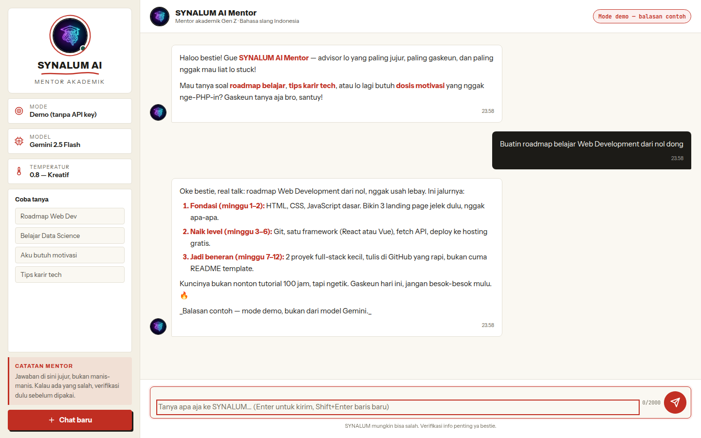

# SYNALUM AI Mentor

Mentor akademik Gen Z: roadmap belajar terstruktur dan feedback jujur buat
mahasiswa tech — dalam bahasa slang Indonesia. Satu endpoint chat
(`POST /api/chat`) ke Gemini 2.5 Flash, satu endpoint health, UI chat
statis, dan mode demo yang jalan tanpa API key.

> **Status deploy — baca dulu:** dokumentasi statis di Cloudflare Pages
> adalah **dokumentasi, bukan API-nya**. API Express butuh server sendiri
> (Docker / Coolify) — lihat [docs/DEPLOY.md](docs/DEPLOY.md). API
> **belum di-deploy**; yang sudah terverifikasi jalan: server lokal mode
> demo + 21 tes + smoke CI.

## Mulai cepat

```bash
git clone https://github.com/dezzorigin/synalum-ai-mentor.git
cd synalum-ai-mentor
npm install
cp .env.example .env   # isi GEMINI_API_KEY — atau kosongkan = mode demo
npm run dev            # http://localhost:3000
```

Buka `http://localhost:3000` untuk UI chat, atau cek health:

```bash
curl -s http://localhost:3000/api/health
# {"status":"ok","mode":"demo","model":"gemini-2.5-flash","version":"1.1.0","uptime_seconds":2}
```

## Contoh pemakaian (asli, mode demo)

```bash
curl -s -X POST http://localhost:3000/api/chat \
  -H "Content-Type: application/json" \
  -d '{"messages":[{"role":"user","content":"Buatin roadmap belajar Web Development dari nol dong"}]}'
```

Respons (dipotong — lengkap di
[`docs/demo/curl-transcript.md`](docs/demo/curl-transcript.md)):

```json
{"reply":"Oke bestie, real talk: roadmap Web Development dari nol, nggak usah lebay. Ini jalurnya:\n\n1. **Fondasi (minggu 1–2):** HTML, CSS, JavaScript dasar…","model":"gemini-2.5-flash","demo":true}
```

## Endpoint

| Method | Path | Untuk |
|---|---|---|
| `GET` | `/api/health` | Status, mode (`live`/`demo`), model, uptime. |
| `POST` | `/api/chat` | Kirim `{messages: [{role, content}]}` → `{reply, model, demo}`. |
| `GET` | `/` | UI chat statis. |

Aturan: `messages` 1–50 item, role `user`/`model` (`assistant` alias),
content 1–4000 karakter, body JSON ≤100 KB, rate limit 30 req/menit/IP
(→ 429 + `Retry-After`). Semua error JSON. Detail lengkap:
[docs/API.md](docs/API.md).

## Mode demo

Tanpa `GEMINI_API_KEY`, server tetap jalan dan membalas dengan balasan
contoh deterministik (roadmap web, data science, motivasi, karir, umum)
+ `"demo": true`. UI chat menampilkan badge `Mode demo — balasan contoh`.
Cocok untuk tes & demo — jangan dipakai menilai kualitas model.

## UI chat



UI chat (`public/`) memakai API yang sama persis: kirim riwayat utuh tiap
request, render markdown (termasuk list bernomor yang benar), chip saran,
chat baru, penghitung karakter, badge mode dari `/api/health`.

## Screenshots

| Gambar | Isi |
|---|---|
| `docs/screenshots/01-chat-desktop.png` | UI chat desktop (mode demo) |
| `docs/screenshots/02-chat-mobile-390.png` | UI chat mobile 390px |
| `docs/screenshots/03-docs-desktop.png` | Situs dokumentasi desktop |
| `docs/screenshots/04-docs-mobile-390.png` | Situs dokumentasi mobile 390px |
| `docs/screenshots/05-silhouette.png` | Tes siluet (thumbnail hitam-putih) |

## Perintah

| Perintah | Arti |
|---|---|
| `npm start` | Jalan mode produksi (port `PORT`, default 3000). |
| `npm run dev` | Jalan dengan `--watch`. |
| `npm test` | 21 tes API (node:test, tanpa key/jaringan). |
| `npm run validate` | Cek referensi lokal + sapu secret + gate anti-slop P0 + html-validate. |
| `npm run smoke` | Smoke end-to-end mode demo (health + chat + UI). |
| `npm run screenshot` | Ambil ulang screenshot dokumentasi. |
| `python3 scripts/advisory-sweep.py` | Sweep dependensi produksi vs OSV (HIGH/CRITICAL = gagal). |

## Deploy

- **Dokumentasi statis (Pages):** `docs-site/` → Cloudflare Pages.
  Nama proyek: `synalum-ai-mentor` (fallback `synalum-mentor` →
  `synalum-ai` bila diambil).
- **API server:** Docker / Coolify di VPS — langkah lengkap
  [docs/DEPLOY.md](docs/DEPLOY.md) (termasuk `Dockerfile` +
  `docker-compose.yml` di repo).

## Dokumen

- PRD: [docs/PRD.md](docs/PRD.md)
- API: [docs/API.md](docs/API.md)
- Arsitektur: [docs/ARCHITECTURE.md](docs/ARCHITECTURE.md) +
  [diagram](docs/architecture.html)
- Deploy: [docs/DEPLOY.md](docs/DEPLOY.md)
- Desain (kontrak anti-slop + referensi): [docs/DESIGN.md](docs/DESIGN.md)
- Demo curl: [docs/demo/curl-transcript.md](docs/demo/curl-transcript.md)

## Lisensi

MIT — lihat [LICENSE](LICENSE).
